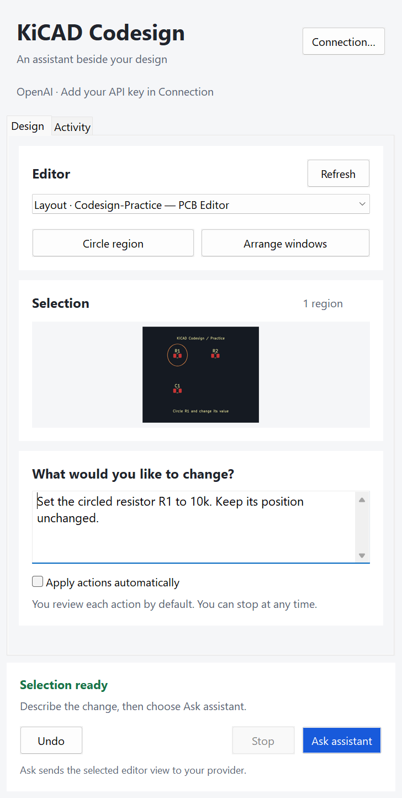
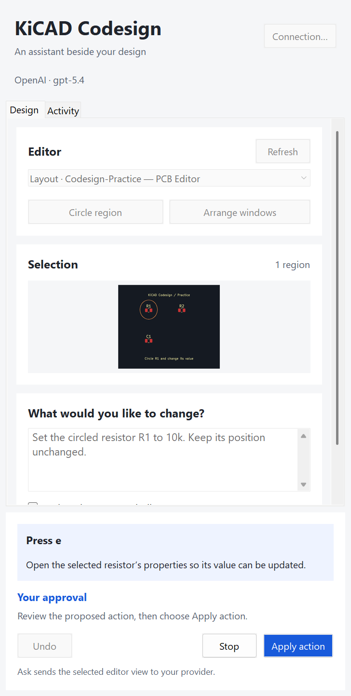
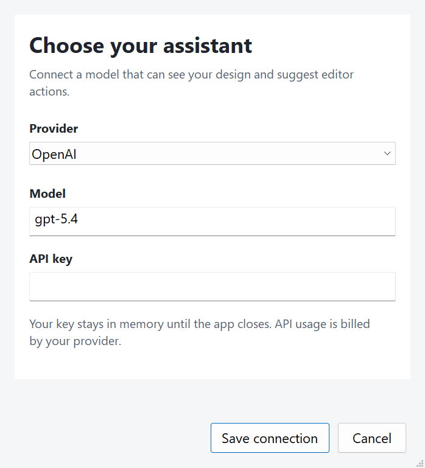

# KiCAD Codesign

**Circle a region. Describe the change. Review it in KiCad.**

A Windows desktop companion that connects your visible KiCad editor to OpenAI, Claude, or a compatible model. Keep the design beside the assistant, review its next action, and watch changes happen in the native editor.

| Describe your change | Review the next action |
| --- | --- |
|  |  |

*Screenshots show the real native interface rendered on an isolated Windows desktop. They use an export of the included practice board and scripted example states. The action-review example is not a live model response.*

**Early prototype.** The interface, provider adapters, and input checks are implemented. The 44 automated tests pass, including native layout and selection checks. Full live editing with OpenAI or Claude has not yet been verified; start with the practice project.

## What you can do

- Choose a **PCB layout, schematic, or footprint editor**.
- Draw one or more regions over a frozen view of that editor, or select the entire view with the keyboard.
- Describe a specific change and review each proposed action before applying it.
- Keep **Stop** and **Apply action** visible while the design controls scroll.
- Follow explanations in **Activity**, inspect before/after screenshots in local history, and use KiCad's native Undo.
- Switch between OpenAI, Claude, and compatible endpoints; each connection keeps its own draft settings for the session.

Codesign uses Windows screenshots and mouse/keyboard input. It does not embed KiCad, use the PCB IPC API, or read the electrical design as structured objects. The three editor types share a visual-control adapter; complete workflows in all three still need validation.

## Start on Windows

1. Install KiCad 10 in its usual `Program Files\KiCad` location. Codesign uses its bundled Python, wxPython, and Pillow.
2. Clone this repository, or download and extract its ZIP.
3. Double-click **Start KiCAD Codesign.cmd**.
4. Open a design in KiCad. In Codesign, choose **Refresh**, then select the intended editor.
5. Open **Connection…**, choose a provider, enter your model ID and API key, then choose **Save connection**.

For a separate Python installation, use Python 3.11 or newer:

```powershell
python -m pip install -r requirements.txt
python launch.py
```

The desktop adapter currently supports Windows only.

## Circle, explain, and review

1. Choose **Arrange windows** to place the editor and assistant side by side. On smaller displays, arrange them manually or use separate monitors.
2. Choose **Circle region** and draw around the target. Choose **Use selection** or press **Enter**. **Clear** starts the selection again; **Cancel** returns to the assistant. **Entire view** selects without drawing.
3. Describe the change, for example: “Set the circled resistor R1 to 10k. Keep its position unchanged.”
4. Choose **Ask assistant**. Read the proposed action and explanation, then choose **Apply action**. The assistant inspects a fresh image after each applied action.
5. Inspect the result in KiCad and save it there. **Undo** sends one native undo; it does not roll back the entire request.

**Apply actions automatically** is off by default. When enabled, each proposed action has a 1.2-second preview before it runs. Turn it off to return to individual review. Each request is limited to 40 actions.

**Stop** discards pending decisions and ignores later responses. A request already sent may finish at the provider, and changes already applied remain in KiCad. A short input action can finish before the Stop button is processed; hold **Esc** for the input adapter's emergency check.

### Keyboard shortcuts

| Action | Shortcut |
| --- | --- |
| Circle a region | Ctrl+Shift+Space |
| Ask or apply the proposed action | Ctrl+Enter |
| Stop | Ctrl+Shift+F12, or hold Esc |
| Connection | Ctrl+, |
| Keep the selection | Enter, in the selection overlay |
| Clear the selection | Backspace or Delete, in the overlay |
| Cancel selection | Esc, in the overlay |
| Select without drawing | Tab to Entire view, then Space |

Global shortcuts can be unavailable if another app has registered them. The interface buttons remain available. **Help → Keyboard shortcuts** lists the controls in the app.

### Try the practice project

Choose **File → Open practice design…** for the included PCB layout or schematic. Both contain standalone R1, R2, and C1 objects; they are not a routed or electrically complete circuit. Finish any KiCad startup dialogs, then choose **Refresh** and select the practice editor.

For footprint work, open KiCad's Footprint Editor, load a footprint, and choose **Refresh** in Codesign. Switching editors clears the previous selection.

## Connect your model



| Provider | Connection | Default model in this version |
| --- | --- | --- |
| OpenAI | Responses API | `gpt-5.4` |
| Claude | Messages API | `claude-sonnet-4-6` |
| OpenAI-compatible | Your endpoint | Enter your model ID |

Model IDs are editable. The model must support images and function calling. You need API access for the provider; Codesign does not connect through a ChatGPT or Claude desktop subscription. Remote compatible endpoints require HTTPS; HTTP is allowed only for localhost.

## Your data

- API keys stay in memory until Codesign closes. You can also supply `OPENAI_API_KEY`, `ANTHROPIC_API_KEY`, or `LLM_API_KEY` through your environment. Codesign does not save those credentials to disk.
- **Ask assistant** sends the annotated reference, current editor or dialog image, prompt, and action history to your chosen provider. Images can include the whole selected editor window, beyond the circled region.
- Local history lives in `sessions/`: prompts, summaries, and before/after screenshots. Open it from **Activity → Open history folder** or **Help → Open session history**. This folder is excluded from Git.
- Saving documents and managing backups remain your responsibility. Interaction screenshots are not restorable design backups.

## Current limits

- Actual editing uses foreground mouse and keyboard input. Keep the selected editor visible and avoid changing it while a request runs. Background screenshot generation for this README does not imply background KiCad editing.
- Visual automation can misidentify objects. Enter exact values through KiCad property fields and independently verify the result. A completed model response is not ERC, DRC, or electrical-design verification.
- Window identity, geometry, and image-change checks reduce stale input, but cannot detect every small change.
- Text entry needs a recognized, focused Windows text control. Custom widgets, localized window titles, unfamiliar dialogs, or custom shortcuts may require manual intervention.
- Model input is limited to a validated action vocabulary and the selected editor's windows. These checks are not a complete security boundary against every operation available in KiCad.
- Running KiCad and Codesign at different Windows privilege levels can block input.

## Development and verification

| Location | Responsibility |
| --- | --- |
| `kicad_codesign/app.py` | Request loop, state transitions, cancellation, and history |
| `kicad_codesign/layout.py` | Main layout and native menus |
| `kicad_codesign/dialogs.py` | Region selection and provider connection |
| `kicad_codesign/ui.py` | Typography, colors, cards, preview, and wrapped text |
| `kicad_codesign/presentation.py` | Readiness, sizing, and validation rules |
| `kicad_codesign/desktop.py` | Windows capture, window scoping, and input |
| `kicad_codesign/protocol.py` | Provider-independent action validation |
| `kicad_codesign/providers.py` | OpenAI, Claude, and compatible connectors |

Run the full suite without putting test windows on your working desktop:

```powershell
& "C:\Program Files\KiCad\10.0\bin\python.exe" tools\run_tests.py
```

The 44 tests cover protocol validation, provider formats, a localhost mock endpoint, stale-view checks, text contrast, compact layouts, connection validation, selection callbacks, and cancellation. They need no API key. The Windows test runner creates a temporary noninteractive desktop and never switches to it.

To regenerate the native interface screenshots, with no desktop input or provider calls:

```powershell
& "C:\Program Files\KiCad\10.0\bin\python.exe" tools\capture_interface.py
```

Public examples go to `docs/images/`; additional visual checks go to the ignored `build/interface-review/` directory. See [the interface review](docs/interface-review.md) for coverage and remaining limits.

To add a provider, implement `build_request(connection, context, images)` and `decode_response(body)`, supply `default_url`, `default_model`, and `env_key`, and register the class in `PROVIDERS`. Return a validated `Decision` through `parse_decision`; provider code must not execute model-generated code.

KiCAD Codesign is an independent project, not an official KiCad, OpenAI, or Anthropic product. See [third-party notices](THIRD_PARTY_NOTICES.md) for practice-design library attribution.
